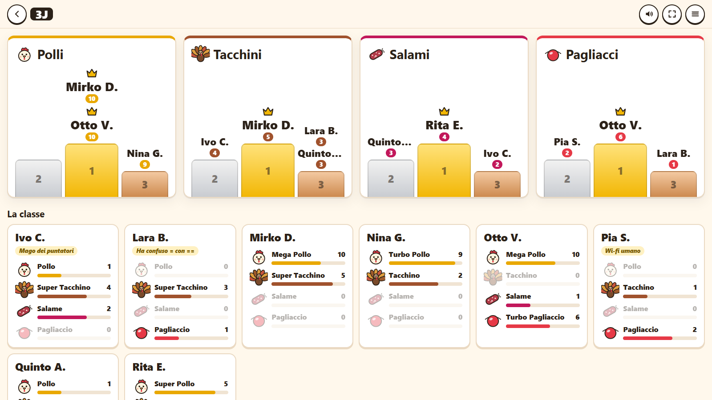
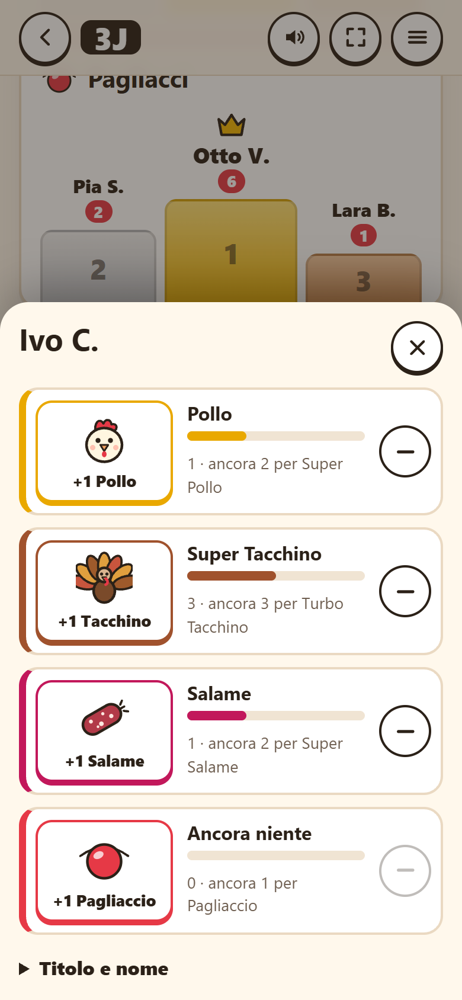

# Il Pollaio

La classifica scherzosa della classe: chi ci casca è un **pollo**, un **tacchino** o, nei casi
gravi, un **salame**. Chi esagera si prende il **naso rosso** da pagliaccio.

Ogni ragazzo ha quattro contatori. A forza di +1 si sale di livello: Tacchino, Super Tacchino,
Turbo Tacchino, Mega Tacchino, fino al leggendario. In cima alla pagina ci sono i podi di ogni
categoria, e chi se lo merita può avere un titolo personalizzato.

Niente punti da calcolare, niente motivazioni da scrivere: un tap e via.

**Sito:** <https://pollaio.federicodiluca.com>

| LIM                                              | Telefono                                                   |
| ------------------------------------------------ | ---------------------------------------------------------- |
|  |  |

_Negli screenshot ci sono solo dati demo inventati._

## Come si usa

1. Apri il sito e collega il tuo Google Sheet (URL della web app e PIN), oppure premi
   **Prova la demo** per giocare con dati finti salvati nel browser.
2. Scegli la classe.
3. Tocca un ragazzo e premi **+1** sulla categoria giusta. Se hai sbagliato, c'è **Annulla**
   nel messaggio in basso, oppure il **-1**.
4. Sulla LIM premi il pulsante dello schermo intero: tutto diventa più grande e la pagina si
   aggiorna da sola ogni 20 secondi.

Quando un ragazzo prende un salame o sale di livello parte **"Boia dei matti!"**, con animazione e
suono.

### Livelli

| volte | livello              |
| ----- | -------------------- |
| 1     | Tacchino             |
| 3     | Super Tacchino       |
| 6     | Turbo Tacchino       |
| 10    | Mega Tacchino        |
| 15    | Tacchino Leggendario |

Uguale per Pollo, Salame e Pagliaccio. Le soglie sono in [`js/categorie.js`](js/categorie.js).

### Menu della classe

- **Aggiungi un ragazzo** e rimetti in classe chi avevi tolto.
- **Backup JSON**: scarica tutto il foglio.
- **Azzera tutto**: scarica prima un backup, poi rimette a zero i contatori della classe
  (nomi e titoli restano). Comodo a fine quadrimestre.

### Il suono

Metti un file `assets/boia-dei-matti.mp3` (anche la tua voce registrata col telefono) e verrà
usato al posto del "wah wah wah" sintetizzato.

## Setup del backend

I dati stanno in un Google Sheet tuo, letto e scritto da un piccolo Google Apps Script
pubblicato come "App web". Niente Google Cloud Console, niente OAuth.

Le istruzioni passo passo sono in [`apps-script/README.md`](apps-script/README.md). In breve:

1. crea un foglio e incolla [`apps-script/Code.gs`](apps-script/Code.gs) in Estensioni > Apps Script;
2. esegui `setup()`;
3. aggiungi la proprietà di script `PIN`;
4. pubblica come App web ("Esegui come: Io", "Chi ha accesso: Chiunque");
5. incolla l'URL `/exec` e il PIN nel sito.

## Sviluppo

HTML, CSS e JavaScript vanilla con ES modules: niente framework e niente bundler.

```sh
npm install        # solo strumenti di controllo
npm run serve      # http://localhost:8080
npm run lint       # html-validate, eslint, prettier, trattino lungo
npm test           # test di livelli e podi
```

```
index.html, classe.html   le due pagine
css/  js/                 stile e logica
assets/icone.svg          tutte le icone (SVG)
apps-script/              backend da incollare in Google Apps Script
```

## Deploy

Ogni push e pull request passa dai controlli (`.github/workflows/ci.yml`). Quando la CI su `main`
è verde, `.github/workflows/deploy.yml` pubblica il sito su GitHub Pages (source "GitHub
Actions"). Il dominio è nel file [`CNAME`](CNAME).

## Privacy

- **Il repository è pubblico e non contiene dati reali.** Nomi e numeri nel codice e negli
  screenshot sono inventati ([`js/demo-data.js`](js/demo-data.js)).
- I dati veri stanno solo nel tuo Google Sheet, privato.
- Ogni richiesta alla web app, in lettura e in scrittura, richiede il PIN. Il PIN sta nelle
  proprietà dello script, non nel foglio né nel codice.
- URL e PIN vengono salvati solo nel browser del dispositivo che usi (localStorage).
- Consiglio: usa nomi brevi o soprannomi, non nomi e cognomi completi.
- Non committare mai i backup JSON (sono già esclusi in `.gitignore`).

## Licenza

[MIT](LICENSE) © Federico Di Luca
